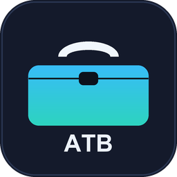

<p align="center"></p>

# ATB — All Tool Box

> 面向 AI Agent 的**全格式文件读取工具箱**：一个命令、一套 schema，把任意文件变成 Agent 能直接消费的文本与结构化数据。
>
> 同时提供 **CLI**、**Python API** 与 **MCP Server** 三种接入方式。

---

## 为什么需要 ATB

Agent 读文件时最常遇到的四类问题：

1. **格式太多**——PDF / DOCX / XLSX / PPTX / EPUB / 压缩包 / 图片 / 音视频 / SQLite / Parquet……每个都要单独的库和调用方式；
2. **扩展名不可信**——`report.txt` 里其实是 PDF，`data.bin` 里其实是 ZIP；
3. **输出不统一**——有的库返回字符串，有的返回对象树，Agent 无法稳定解析；
4. **失败不友好**——报一个底层异常，Agent 不知道该重试、换参数还是放弃。

ATB 的做法：**统一探测 → 统一解析 → 统一 Document schema → 统一错误码（含解决方案）**。

---

## 核心能力

| 能力 | 说明 |
|---|---|
| 双重格式探测 | 扩展名映射 + 魔术字节（magic bytes）；改错扩展名也能识别；ZIP 容器自动细分 docx/xlsx/pptx/apk/epub/jar/whl |
| 统一输出 | `Document { metadata, blocks[], text, warnings, truncated, error }`，支持 `text / markdown / json` 三种渲染 |
| 结构感知 | 标题层级、段落、表格、代码块、图片、页码（PDF）、工作表名（Excel）、单元格（PPT）、字幕时间轴 |
| 优雅降级 | 缺少某个依赖时退回内置纯标准库实现，并明确告知降级原因，不会直接崩溃 |
| 安全默认 | 压缩包只列目录、不自动解压（防 Zip Slip）；大文件按字节/字符双重截断 |
| 错误码体系 | `ATB-Eccnnn`，每条都带**成因 + 分步解决方案**，Agent 可据此自主决策 |
| 三种接入 | CLI 子命令、`import atb` Python API、stdio MCP Server（零额外依赖） |

---

## 支持的格式

| 类别 | 格式 | 解析深度 |
|---|---|---|
| 文档 | `pdf` | 元数据、目录、逐页正文、表格、图片计数、加密检测 |
| Office | `docx` `docm` `xlsx` `xlsm` `pptx` `pptm` | 标题/段落/表格/工作表/幻灯片/备注 |
| OpenDocument | `odt` `ods` `odp` | 段落、标题、表格 |
| 旧版 Office | `doc` `xls` `ppt` `wps` `et` `dps` | OLE 容器字符串提取（建议先转换） |
| 文本 | `txt` `md` `rst` `log` `ini` `cfg` `properties` 等 | 编码探测（UTF-8/GBK/GB18030/Big5…）、Markdown 结构还原 |
| 源码 | 60+ 扩展名（py/js/ts/java/go/rs/c/cpp/cs/sql/sh/ps1…） | 语言标注、代码块输出 |
| 网页 | `html` `htm` `xml` `svg` `rss` `atom` | 标题、段落、链接数、表格、正文抽取 |
| 结构化数据 | `json` `jsonl` `yaml` `toml` `csv` `tsv` | 结构摘要、字段名、表格化、行数统计 |
| 数据库 | `sqlite` `db` | 表清单、字段类型、行数、采样数据 |
| 列式数据 | `parquet` `arrow` `feather` | Schema、行组、压缩方式、采样 |
| 表格 | `xlsx` `xls` `csv` | 逐工作表/逐行输出，支持 `--sheet` |
| 电子书 | `epub` `mobi` `azw3` `fb2` `cbz` `cbr` | EPUB 按 spine 顺序逐章抽取；MOBI 头部元数据 |
| 图片 | `png` `jpg` `webp` `gif` `tiff` `bmp` `heic` `avif` `psd` `ico` | 尺寸、模式、EXIF、帧数；可选 OCR |
| 音视频 | `mp3` `flac` `wav` `m4a` `ogg` `opus` · `mp4` `mkv` `avi` `mov` `webm` | 时长、码率、采样率、标签；有 ffprobe 时输出完整流信息 |
| 视频理解 | `mp4` `mkv` `avi` `mov` `webm` | **逐帧抽帧 + 时间轴 + MCP 图片回传**，让视觉模型真正看到画面；可导出音轨 |
| 视频分镜（实验性） | `mp4` `mkv` `avi` `mov` `webm` | **一张宫格图看全片**：编号 + 时间码 + 音频包络，按剪辑密度分格，格内取最清晰帧 |
| 压缩包 | `zip` `7z` `rar` `tar` `gz` `bz2` `xz` `jar` `apk` `whl` `iso` | 条目清单、压缩率、加密检测、`--member` 读取内部文本 |
| 字幕 | `srt` `vtt` `ass` `ssa` `lrc` | 逐条字幕 + 时间轴 |
| 邮件 | `eml` `msg` `mbox` | 主题/收发人/正文/附件清单 |
| 日历联系人 | `ics` `vcf` | 事件/联系人字段 |
| 字体 | `ttf` `otf` `woff` `woff2` | name 表：字体族、子族、版本 |
| 可执行 | `exe` `dll` `sys` | PE 头：架构、节区、时间戳 |
| 未知二进制 | 任意 | 十六进制头、熵值、可打印字符串、格式线索 |

> 完整矩阵：`python main.py formats --json`

---

## 环境要求

- **Python 3.10+**（开发验证环境为 3.14）
- **Windows / Linux / macOS**
- 可选外部工具：`ffprobe`（音视频深解析）、`tesseract`（扫描件 OCR）、`unrar`（RAR 解压）

---

## 安装

```bat
cd /d D:\ATB
python -m venv .venv
.venv\Scripts\python -m pip install -r requirements.txt

:: 国内网络建议加镜像
.venv\Scripts\python -m pip install -r requirements.txt -i https://pypi.tuna.tsinghua.edu.cn/simple
```

不装依赖也能启动：核心的文本/源码/CSV/JSON/压缩包/HTML 解析是纯标准库实现，
其余格式会降级并在 `warnings` 里说明原因。环境自检：

```bat
.venv\Scripts\python main.py doctor
```

---

## 快速开始

```bat
:: 读取文件（自动识别格式，人类可读输出）
python main.py read "D:\docs\报告.pdf"

:: 输出 Markdown（最适合喂给 Agent）
python main.py read "D:\docs\报告.pdf" --md

:: 输出 JSON（结构化，含 blocks / metadata / warnings）
python main.py read "D:\docs\数据.xlsx" --json --sheet 销售

:: 只取纯文本
python main.py text "D:\docs\合同.docx"

:: 轻量探测（不解析正文，返回格式/大小/哈希）
python main.py info "D:\downloads\unknown.bin"

:: 目录扫描：统计这堆文件是什么
python main.py scan "D:\downloads" --limit 2000

:: 读 PDF 指定页 / 压缩包指定条目
python main.py read "D:\docs\manual.pdf" --pages 3-8
python main.py read "D:\pkg\src.zip" --member src/main.py

:: 强制指定格式（扩展名不可信时）
python main.py read "D:\logs\weird.txt" --format pdf

:: 服务模式：MCP Server
python main.py mcp
```

### CLI 体验

- 长任务（视频抽帧、分镜）显示单行进度条与 ETA，输出到 stderr，不污染 `--json` 的 stdout：

  ```
  扫描切点 ⠋ 2.4s
  抽取画面 [████████░░░░░░░░] 50%  24/48  ETA 2.1s  5/16 格
  生成宫格 [████████████████] 100%  4/4  ETA 0.0s  sheet 4/4
  ```

- `--no-progress` 关闭进度；非 TTY 环境（管道、CI）自动关闭
- `--threads N` 指定工作线程：`0`=自动（最多 4）、`1`=单线程；放在子命令前后都可以
- 完成时输出耗时摘要：`完成 · 1.82s · 线程 4`

### 视频理解（让 Agent 真正看懂画面）

```bat
:: 默认抽 12 帧、768px
python main.py video "D:\videos\demo.mp4"

:: 长视频分段：30-60 秒一段，每段 8-16 帧
python main.py video "D:\videos\demo.mp4" --start 60 --end 120 --frames 12

:: 剪辑类视频按关键帧采样；同时导出音轨
python main.py video "D:\videos\demo.mp4" --scene --audio

:: 结构化输出（含帧路径、预算估算）
python main.py video "D:\videos\demo.mp4" --json
```

MCP 模式下 `atb_read_video` 会把帧作为 **image content** 直接回传，视觉模型看到的是真实画面，
而不是文字描述。时间轴用于定位，例如：

```
## 帧时间轴
- 0:13.8 · 768×432 · 21 KB · `D:\ATB\reports\frames\InterfaceWar_xxx\frame_001_t0013.83s.jpg`
```

**预算原则（不设硬上限，但必须给足风险提示）**：

| 项目 | 建议值 | 说明 |
|---|---|---|
| 单帧体积 | ≤ 1 MB | 768px 长边 + JPEG q80 通常 40–150 KB |
| 整包体积 | ≤ 8 MB | base64 后约 11 MB；默认 12 帧一般 1.5–4 MB |
| 单帧 tokens | `ceil(宽×高/750)` | 768×432≈442；1280×720≈1229；1920×1080≈2765 |
| 图片 token 预算 | ≤ 上下文 25% | 128k→32k≈72 帧(768p)；32k→8k≈18 帧 |
| 参数上限 | frames 1–240，width 128–1920 | 超出建议值仍会执行，但会写入 warnings |

**能力声明**：视频理解依赖模型的**原生图像输入能力**。MCP 的工具描述与 `initialize.instructions`
都明确要求模型：若自身不具备视觉能力，必须直接告诉用户「无法查看画面」，
不得根据文件名或元数据臆测内容。`atb_video_guide` 可随时查询完整预算指南。

### 实验性：视频分镜（Storyboard）

> ⚠ 实验性功能：参数、阈值与输出结构可能随版本调整，不建议用于稳定流水线。

把整段视频压成**一张可寻址的宫格图**：每格带编号与时间码，格位按剪辑密度分配
（快切区格子更短、更密），格内从 3 个候选帧里按 Laplacian 方差挑最清晰的一张，
底部再叠加与画面同时间轴的音频包络。

```bat
:: 默认 9-16 格自动分格，一张图
python main.py storyboard "D:\videos\demo.mp4"

:: 指定格数 / 分两张图 / 单张像素预算
python main.py storyboard "D:\videos\demo.mp4" --cells 12 --sheets 2 --budget 1200000

:: 只看某一段
python main.py storyboard "D:\videos\demo.mp4" --start 60 --end 180
```

MCP 工具 `atb_video_storyboard` 会把宫格图作为 image content 直接回传。实测对比
（1080p 样片）：

| 方案 | 覆盖范围 | 图片 | 预计 tokens |
| --- | --- | --- | --- |
| 逐帧 `atb_read_video`（12 帧） | 12 个瞬间 | 12 张 | ≈ 5,300 |
| 分镜 `atb_video_storyboard`（9 格） | 全片 | 1 张 | ≈ 2,300 |

处理耗时（1080p，同机实测）：

| 视频 | 总耗时 | 切点检测 / 取帧 | 分格 |
| --- | --- | --- | --- |
| SixDigits（60s） | 1.8s | 0.6s / 0.9s | 7 格 |
| OneTimeIdentity（138s） | 3.7s | 1.3s / 2.0s | 11 格 |
| InterfaceWar（332s） | 8.0s | 2.8s / 4.8s | 12 格 |

切点扫描只解码参考帧（`skip_frame=NONREF`），比全帧解码快约一倍，切点数量实测不变；
候选帧缩放/锐度计算走线程池，音频包络与切点扫描并行，多图渲染并行。
`storyboard.timings` 会返回各阶段耗时（cuts / grab / audio / render / total）与线程数。

算法思路参考开源项目 [SAOS-3624/dsh-video-storyboard](https://github.com/SAOS-3624/dsh-video-storyboard)
（Apache-2.0），本项目为基于 PyAV + Pillow 的独立 Python 实现，未复制其源码。
与上游的差异：不依赖 ffmpeg 可执行文件、**不含 ASR/台词转写**、不支持 URL 输入。

推荐工作流：先用分镜图建立全片概览，再用 `atb_read_video --start/--end` 对关键段细看。

不带参数运行进入**交互菜单**：

```bat
python main.py
```

```
┌──────────────────────────────────────────────────────────────────────────┐
│ ATB (All Tool Box)  v1.2.0                                               │
│ 面向 AI Agent 的全格式文件读取工具箱                                      │
└──────────────────────────────────────────────────────────────────────────┘

  [1] 读取文件（自动识别格式）
  [2] 提取纯文本
  [3] 查看文件信息（轻量探测）
  [4] 扫描目录并统计格式
  [5] 查看支持的格式
  [6] 环境自检 doctor
  [7] 启动 MCP Server（stdio）
  [8] 错误码速查
  [9] 视频抽帧（供视觉模型理解）
  [10] 视频分镜图（实验性）
  [0] 退出
```

---

## Python API

```python
import atb
from atb.models import ReadOptions

doc = atb.read_file(r"D:\docs\报告.pdf", ReadOptions(max_chars=50_000))
print(doc.format)        # "pdf"
print(doc.handler)       # "pdf.pymupdf"
print(doc.metadata)      # {"pages": 12, "title": "...", ...}
print(doc.text())        # 拼接后的纯文本
print(doc.to_dict())     # 可直接 json.dumps

# 只取文本
text = atb.extract_text("D:\docs\合同.docx")

# 只探测不解析
info = atb.file_info("D:\downloads\unknown.bin")

# 容错模式：不抛异常，返回 ok=False + error
doc = atb.read_file("D:\nope.pdf", safe=True)
print(doc.error["code"])  # ATB-E01001
```

---

## MCP Server 接入

ATB 内置的 MCP Server 使用 **stdio + JSON-RPC 2.0**，不依赖任何 MCP SDK 或第三方包。

### 配置示例（Claude Desktop / Trae / Cursor 通用）

```json
{
  "mcpServers": {
    "atb": {
      "command": "D:\\ATB\\.venv\\Scripts\\python.exe",
      "args": ["D:\\ATB\\main.py", "mcp"]
    }
  }
}
```

打包成 exe 后更简单：

```json
{
  "mcpServers": {
    "atb": {
      "command": "D:\\ATB\\dist\\ATB.exe",
      "args": ["mcp"]
    }
  }
}
```

仓库内的 [mcp.example.json](mcp.example.json) 可直接复制修改。

### 提供的工具

| 工具 | 作用 |
|---|---|
| `atb_read_file` | 读取任意文件，返回完整 Document（元数据 + 块 + 文本） |
| `atb_read_video` | 抽帧并回传 **image content**，让视觉模型直接看画面；带时间轴与预算提示 |
| `atb_video_storyboard` | **实验性**：整段视频 → 一张宫格分镜图（编号/时间码/音频包络），token 更省 |
| `atb_video_guide` | 视频预算指南：MB 建议、token 公式、不同上下文窗口的帧数上限 |
| `atb_extract_text` | 只返回纯文本，适合直接进上下文 |
| `atb_file_info` | 轻量探测：格式/MIME/大小/SHA256 |
| `atb_scan_directory` | 扫描目录，统计格式分布 |
| `atb_search_text` | 在任意格式文件中搜索关键词并返回上下文 |
| `atb_read_batch` | 批量读取多个文件 |
| `atb_list_formats` | 查询支持的格式矩阵 |

工具出错时返回 `isError: true` 与完整错误码/解决方案，Agent 可据此重试。

---

## 统一输出 Schema

```json
{
  "ok": true,
  "path": "D:\\docs\\报告.pdf",
  "format": "pdf",
  "handler": "pdf.pymupdf",
  "mime": "application/pdf",
  "size": 123456,
  "size_human": "120.6 KB",
  "mtime": "2026-10-31 10:00:00",
  "sha256": "…",
  "metadata": { "pages": 12, "title": "季度报告", "author": "…" },
  "stats": { "blocks": 48, "words": 3200, "chars": 21000 },
  "truncated": false,
  "warnings": [],
  "blocks": [
    { "type": "heading", "text": "第 1 页", "level": 3, "page": 1 },
    { "type": "paragraph", "text": "正文……", "page": 1 },
    { "type": "table", "meta": { "rows": [["列1", "列2"], ["a", "b"]] } }
  ],
  "text": "全文……"
}
```

`blocks[].type` 取值：`heading` `paragraph` `list` `code` `table` `image` `kv` `raw`。
定位信息：`page`（PDF/PPT）、`sheet`（Excel/SQLite）、`level`（标题层级）。

---

## 错误码

编号格式 `ATB-E<2 位类别><3 位流水>`：

| 类别 | 覆盖范围 |
|---|---|
| `E00xxx` | 通用：未捕获异常、用户中断、参数无效、文件过大 |
| `E01xxx` | 文件访问：不存在、权限、占用、目标是目录 |
| `E02xxx` | 格式识别：无法识别、扩展名与内容不符 |
| `E03xxx` | 文本编码：解码失败、疑似二进制 |
| `E04xxx` | 办公文档：解析失败、旧版格式限制 |
| `E05xxx` | PDF：解析失败、无文本层 |
| `E06xxx` | 图片音视频：解析失败、元数据不可读 |
| `E07xxx` | 压缩包：损坏、加密、Zip Slip |
| `E08xxx` | 结构化数据：语法错误、SQLite 不可读 |
| `E09xxx` | 输出写入 |
| `E10xxx` | MCP 协议 |
| `E11xxx` | 依赖缺失 |

查询：

```bat
python main.py err                :: 分类总览 + 用法
python main.py err 01001          :: 单条详情（完整解决方案，自动换行）
python main.py err 01             :: 按类别列出（01 / 文件访问 / PDF 都行）
python main.py err pdf            :: 关键词搜索
python main.py err --all          :: 展开全部 27 条
python main.py err --json         :: 结构化输出，便于程序消费
```

编号规则：`ATB-E<2 位类别><3 位流水>`，例如 `ATB-E01001`。输入时可以简写为 `1001`、`01001` 或 `E01001`。
最近 50 条错误会写入 `reports/atb_error_log.json`，便于复盘。

---

## 打包（PyInstaller，单文件）

```bat
build.bat
```

`build.bat` 会：

1. 优先使用 `.venv\Scripts\python.exe`（不存在则用系统 Python）；
2. 缺少 `atb.ico` 时自动运行 `make_icon.py` 生成图标；
3. 检查 PyInstaller，缺失时给出安装命令；
4. 执行 `pyinstaller ATB.spec --noconfirm --clean`；
5. 报告产物路径与体积。

产物：`dist\ATB.exe`（单文件、控制台程序，带专属图标与 Windows 版本资源）。参数与源码运行完全一致：

```bat
dist\ATB.exe read "D:\docs\报告.pdf" --md
dist\ATB.exe mcp
```

设计要点（详见 [ATB.spec](ATB.spec) 头部注释）：

- `onefile` + `console=True`：保留 CLI 与 MCP stdio；
- `icon` + `version`：写入 `atb.ico` 与产品名/版本/版权等文件属性；
- 解析库按需收集，`tkinter/matplotlib/pandas/scipy` 显式排除，控制体积；
- `optimize=0`：保留模块 docstring（`--help` 文本）；
- `upx=False`：降低杀软误报，构建更稳定；
- 外部工具（ffprobe/tesseract）不内置，运行时从 `PATH` 查找。

图标由 [make_icon.py](make_icon.py) 用 Pillow 程序化绘制（深色圆角底 + 青蓝渐变工具箱 + ATB 字样），
输出含 256/128/64/48/32/16 六种尺寸的 `atb.ico`，可随时改配色后重新生成：

```bat
python make_icon.py
```

> 若只需核心能力，可先卸载 `pyarrow` 再打包，产物会小很多；Parquet 将自动降级并提示。

---

## 目录结构

```
ATB/
├─ main.py                入口：CLI 子命令 / 交互菜单 / 错误渲染
├─ config.py              应用元信息与全局默认值
├─ atb/
│  ├─ __init__.py         对外 API：read_file / extract_text / file_info / scan_directory
│  ├─ detect.py           扩展名映射 + 魔术字节探测 + ZIP 家族细分
│  ├─ dispatch.py         解析调度与容错
│  ├─ models.py           Document / Block / ReadOptions 数据模型
│  ├─ output.py           text / markdown / json 渲染
│  ├─ scanner.py          目录扫描与格式统计
│  ├─ mcp.py              stdio MCP Server（JSON-RPC 2.0）
│  ├─ ui.py               ANSI 颜色、横幅、等宽表格
│  ├─ progress.py         进度条 / spinner / ETA（stderr，TTY 自动启用）
│  ├─ errors.py           错误码体系与错误日志
│  ├─ readers/
│  │  ├─ base.py          基类、编码探测、页码解析、Document 构造
│  │  ├─ text.py          纯文本 / 源码 / Markdown
│  │  ├─ office.py        DOCX / XLSX / XLS / PPTX / ODF / RTF / 旧版 OLE
│  │  ├─ pdf.py           PDF（PyMuPDF + 内置降级）
│  │  ├─ web.py           HTML / XML / EPUB / FB2 / MOBI
│  │  ├─ data.py          JSON / JSONL / YAML / TOML / CSV / SQLite / Parquet / ipynb
│  │  ├─ media.py         图片 / 音频 / 字体 / PE
│  │  ├─ video.py         视频抽帧 / 时间轴 / 预算估算（PyAV）
│  │  ├─ archive.py       ZIP / TAR / 7Z / RAR / GZ / BZ2 / XZ
│  │  └─ misc.py          字幕 / 邮件 / 日历 / 未知二进制
│  └─ experimental/
│     └─ storyboard.py    【实验性】场景分镜：切点检测 / 分格 / 宫格图（PyAV + Pillow）
├─ tests/                 单元测试（标准库 unittest，56 用例）
├─ reports/               运行期错误日志（自动创建）
├─ requirements.txt
├─ atb.ico                exe 图标（由 make_icon.py 生成）
├─ atb_icon_preview.png   图标预览（README 展示用）
├─ make_icon.py           程序化生成多尺寸图标
├─ ATB.spec               PyInstaller 配置（图标 + 版本资源）
├─ build.bat              一键打包
├─ atb.bat                便捷启动器（自动使用 .venv）
└─ mcp.example.json       MCP 配置示例
```

---

## 测试

```bat
python -m unittest discover -s tests -v
```

覆盖：格式探测（魔术字节、ZIP 细分、强制格式）、读取链路（文本/Markdown/GBK/CSV/JSON/JSONL/压缩包/成员读取）、
错误处理（缺失文件、目录、safe 模式）、错误码归一化、目录扫描、MCP 协议（initialize / tools/list / tools/call /
错误返回 / 未知方法 / Content-Length 分帧）、视频抽帧（现场编码小视频后读取、时间窗、帧差异、关键帧采样、
MCP image content 回传）、实验性分镜（切点检测、多图分格、时间窗、音频包络与导出、MCP 宫格图回传）、
进度组件（进度/ETA、spinner、禁用态）。

---

## 安全说明

- **只读**：ATB 不对源文件做任何写操作（`--out` 除外，且只写你指定的路径）。
- **不解压**：压缩包默认只列目录；读取内部条目时仅在内存中解压，不落盘，避免 Zip Slip。
- **不联网**：除可选依赖安装外，运行期无任何网络请求。
- **隐私**：文件内容只在本机处理；MCP 模式下内容由客户端决定是否发送给模型。

---

## 参考与致谢

- 视频分镜的算法思路参考 [SAOS-3624/dsh-video-storyboard](https://github.com/SAOS-3624/dsh-video-storyboard)
  （Apache-2.0）：HSV 三通道切点检测、按局部剪辑密度分配格位、Laplacian 方差选帧、音频包络同轴绘制。
  本项目为基于 PyAV + Pillow 的独立 Python 实现，**未复制其源码**；差异见「实验性：视频分镜」。
- PDF / Office / 压缩包 / 视频解码等能力来自 PyMuPDF、python-docx、openpyxl、python-pptx、py7zr、PyAV 等开源项目，详见 [requirements.txt](requirements.txt)。

---

## 许可

```
© 2026 LFTAniyra。源代码以 MIT License 授权。
```
